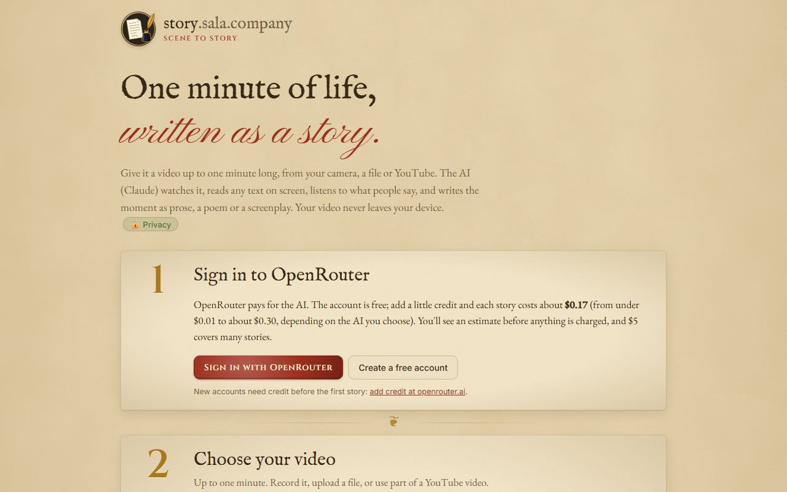

# Scene to Story

**Live: [story.sala.company](https://story.sala.company)** · part of [Sala Company](https://go.sala.company)

<br clear="left">

Record, upload or pick a YouTube clip up to one minute long. The AI (currently Claude) watches it, reads any text on screen, describes the people, listens to what they say, and writes about the moment as literary prose with dialogue, a poem, a screenplay, a noir story, a haiku sequence or a fairy tale.

It's a static site on GitHub Pages: no server, no database, nothing to pay for hosting. Visitors sign in with their own OpenRouter account, which pays for the AI.

[](https://story.sala.company)

## How it works

```
Video (camera, upload, or a YouTube link + timestamp; up to 60 s)
 ├─ Frames: 1 per second (or 2, or 1 every 2 s), captured in the browser with <canvas>
 ├─ Speech: transcribed in the browser by Whisper (Transformers.js, in a Web Worker)
 └─ AI (Claude) through OpenRouter, signed in with OAuth (PKCE)
      1. Watching (Sonnet 5.5 by default): text on screen, characters, timeline and
         who said what, returned in a strict JSON format
      2. Writing (Opus 5.5 by default): the piece, streamed onto the page
```

- **Sign-in:** "Sign in with OpenRouter" uses OAuth PKCE, so it needs no server or secret. Returning users go through OpenRouter's sign-in page, and new users get a separate "Create account" link. The key is kept in the visitor's browser until they sign out, and never in this repo.
- **Two models:** a cheaper model watches the frames, which is most of the input, and the best model writes. Both can be changed on the page.
- **YouTube:** paste a link (a `?t=1m30s` timestamp fills in the start time) and choose a length, which defaults to 60 seconds. A static page can't download from YouTube, so the clip plays in YouTube's own embedded player while the page records its own tab, cropped to the player. When the browser asks, share **this tab** with **"Also share tab audio"** ticked. It records in real time and needs desktop Chrome or Edge (Firefox records without sound). Videos whose owners block embedding can't be used. Only capture videos you have the right to use.
- **Reliability:** rate limits, server errors and dropped connections are retried automatically (up to 3 attempts, honouring `Retry-After`), but never after part of a story has appeared. The analysis is asked for again once if it still comes back unreadable. A **Cancel** button stops any step.
- **Cost:** an estimate before you start, from OpenRouter's live prices, and the actual cost OpenRouter reports afterwards.
- **Large files:** for uploads over 150 MB, the sound isn't decoded in one go. The first minute is played silently and recorded instead, in real time.
- **Speech model:** Whisper base (8-bit), about 80 MB, downloaded once from Hugging Face and then cached by the browser.

## Privacy

A **🔒 Privacy** button right after "Your video never leaves your device." opens a pop-up that tells visitors this in plain language (the step 4 "Details" link and the footer link open it too, as does `#privacy` in the address).

| What | Where it goes |
|---|---|
| The video and its sound | Stays on the device. Speech is turned into text on the device, too. |
| Still frames and the speech transcript | Sent to the AI (Claude, made by Anthropic) through OpenRouter, only when "Write the story" is pressed |
| The story and the AI's notes | Shown on the page only, and gone on reload unless the visitor copies or downloads it |
| OpenRouter sign-in and settings | Saved in the visitor's browser. "Sign out" removes them. |

Nothing is sent back to this site. The page also loads fonts from Google Fonts, the speech model from Hugging Face and jsDelivr, and the YouTube player when a YouTube link is used.

## Cost per story (paid by the visitor through OpenRouter)

Rough figures for a one-minute 16:9 video at 1 frame per second. The page shows its own estimate for each video.

| Watching → Writing | Approx. cost |
|---|---|
| Sonnet 5.5 → Opus 5.5 (default) | ~$0.17 |
| Haiku 5.5 → Opus 5.5 | ~$0.08 |
| Opus 5.5 → Opus 5.5 | ~$0.26 |
| Sonnet 5.5 → Fable 5.1 | ~$0.27 |
| Haiku 5.5 → Haiku 5.5 | under $0.01 |

A rewrite in another style costs only the writing step.

## Hosting

GitHub Pages serves the `main` branch at `story.sala.company` (see `CNAME`; DNS is a `CNAME` record for `story` pointing to `jamalxcode.github.io`), with HTTPS enforced. Every push to `main` goes live in about a minute. The old address, `jamalxcode.github.io/storywriter`, redirects here.

OpenRouter's PKCE sign-in accepts any HTTPS callback address, so a move to another domain needs no OpenRouter settings. Visitors just sign in again on the new address.

## Run locally

Camera access and ES modules need `http://localhost` or HTTPS, so opening `index.html` directly won't work. Any static server will do:

```bash
npx serve .
```

## Files

| File | What it is |
|---|---|
| `index.html` | Page layout: the four numbered steps (sign in, choose a video, writing style, write), the results and the privacy pop-up |
| `style.css` | Styling, with light and dark modes |
| `app.js` | Recording, YouTube capture, frame capture, OpenRouter sign-in, AI calls, cost estimate, rendering |
| `whisper-worker.js` | Speech-to-text in a background thread |
| `logo.svg` | The logo (a gold quill, inkpot and document), also used as the favicon |
| `screenshot.jpg` | The screenshot in this README |
| `CNAME` | The custom domain, `story.sala.company` |

## Limits

- Only the first 60 seconds of a video are used.
- Speakers are matched from the frames, not by voice, so it works best with one or two people on screen.
- Very fast action between frames can be missed. Choose "2 per second" for those clips.
- The browser must be able to play the video format. MP4 and WebM work everywhere; some phone HEVC files play only in Safari.
- Capturing from YouTube doesn't work on phones.
